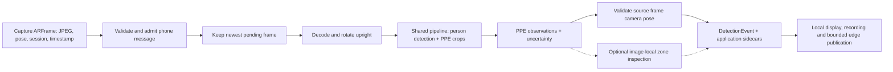
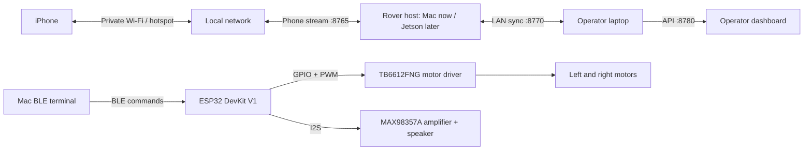
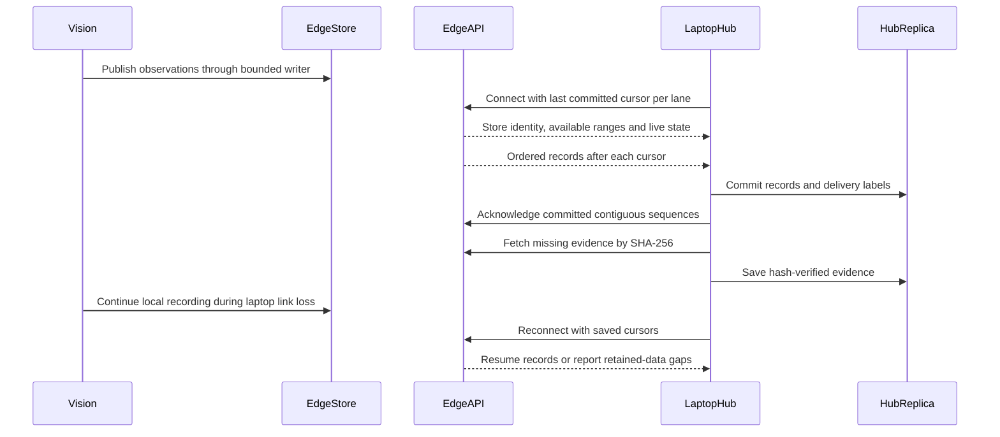

# BOB — Construction Inspection Rover

[MIT license for original code](LICENSE) · [CV guide](README-CV.md) · [Backend plan](docs/plans/dashboard-twin-integration-plan.md) · [Hugging Face roadmap](docs/plans/hugging-face-implementation-plan.md)

BOB is a Knight Hacks construction-inspection prototype that combines an iPhone camera and ARKit pose, local PPE detection, and an evidence backend that synchronizes with an operator laptop. The goal is to help a human reviewer inspect selected PPE conditions and controlled restricted zones, with the original observation and its uncertainty available for review.

**Current deployment:** the Jetson runs local vision; the Mac development path remains supported. Live phone capture, vision, local storage, rover-to-laptop synchronization and a local browser dashboard are implemented. The dashboard shows measured confidence/FPS/Hz, connections, preview, logs, evidence and a digital twin, and lets a site manager save PPE requirements and explicitly start/end an inspection. Physical dashboard/worksite acceptance, hands-free navigation and remaining Jetson acceptance are pending. [Dashboard setup and workflow](docs/plans/digital-twin-frontend-guide.md). Motor control lives in a separate ESP32 client, outside the vision pipeline.

This is a controlled demonstration, not a certified safety system. A detection does not establish PPE certification or permission for the rover to move.

**Jetson supervised driving checkpoint (2026-10-11):** mounted-camera photos show
usable floor foreground. A separate `navigation.supervised` command now offers
one operator-authorized 100 ms BLE step at a time, with stopped observation periods,
person/PPE pauses and the working ESP32 firmware. Dry run is the default; physical
stopping/direction acceptance is pending. [Setup, camera assessment and controls](docs/supervised-camera-driving.md).

**Arrow-key remote:** run this on the Mac (or a Jetson desktop) near the robot:

```bash
uv run --no-project --with bleak==3.0.2 --with pygame==2.6.1 python -m hardware.esp32.remote
```

Click the remote window and hold an arrow key to move. Release to stop; Space
stops, Esc quits. It detects either existing BOB firmware; no camera, server,
phone, or firmware upload is needed. Close other BLE clients first.
[Remote setup](docs/remote-control.md). Point driving has been removed.

**Mac wander demo:** turn-led scanning, brief person/PPE inspection, existing Missing PPE
speech, archived frame references and bounded turn-away. Start/pause locally;
no obstacle avoidance. [Two-terminal setup](docs/mac-wander-demo.md).

The website includes worksite/PPE dropdowns, an export of displayed detection records as CSV, and worker privacy and prototype terms pages. The homepage uses the selected dusk worker photograph. Image retention is limited by policy to 7 days for routine images and 30 days for incident evidence; deletion across all copies remains operator-managed. See [website behavior and policy details](web/README.md).

## System overview

```mermaid
flowchart LR
    phone["iPhone: ARKit + camera"]
    subgraph rover ["Rover computer: Mac today, Jetson planned"]
        vision["Python vision server"]
        writer["Bounded edge writer"]
        edgeStore[("SQLite WAL + evidence files")]
        edgeApi["Edge sync API :8770"]
        vision --> writer
        writer --> edgeStore
        edgeStore --> edgeApi
    end
    subgraph laptop ["Operator laptop: same Mac during development"]
        hub["Hub sync client"]
        replica[("Local replica + evidence cache")]
        hubApi["Frontend API :8780"]
        hub --> replica
        replica --> hubApi
    end
    phone -->|"Local WebSocket :8765"| vision
    edgeApi <-->|"Resume, records, acknowledgments and blobs"| hub
    hubApi -->|"REST; WebSocket API available"| browser["Operator dashboard / 2D Twin"]
```



The operational data path stays on the local network. The hub catches up after a link interruption; backfilled observations remain distinguishable from current state. The proposed Hugging Face showcase uses separately curated public examples, not a live rover upload.

### Frame-to-evidence workflow



The phone captures and transmits; Python owns model inference and assessment. A slow detector replaces old pending frames instead of building an inference backlog. Invalid pose leaves an observation unlocalized; it does not erase the detection or substitute a newer pose. The frame's own timestamp and session connect image, boxes and pose.

### Device connectivity

| Connection | Protocol / default endpoint | What travels | Setup boundary |
| --- | --- | --- | --- |
| iPhone → rover computer | `ws://<rover-address>:8765` | Length-prefixed JSON header + JPEG; pose messages | Private local Wi-Fi; iOS camera/local-network permission |
| Laptop hub ↔ edge API | `ws://<rover-address>:8770/v1/sync` | Live state, ordered records, resume cursors, acknowledgments | Same `BOB_EDGE_TOKEN` on edge and hub for LAN access |
| Laptop hub → edge API | `http://<rover-address>:8770/v1/blobs/<sha256>` | Evidence image retrieval | Hash verified before use; bandwidth capped |
| Browser → laptop hub | `http://<laptop-address>:8780/v1/...`, `ws://<laptop-address>:8780/v1/live` | Metrics, status, detections, evidence, logs, requirements and explicit inspection commands | Local dashboard uses bounded REST polling and token headers; configure the browser origin for direct access |
| Hub ↔ optional sample edge | `ws://127.0.0.1:8771/v1/sync` | Synthetic demonstration records | Separate SAMPLE store and workspace |
| Mac terminal → ESP32 | Bluetooth Low Energy | Manual motor/speaker commands | Independent bench test; not connected to CV or hub |



The diagrams show logical roles: during development, the rover host and laptop hub can run as separate processes on one Mac. No internet connection is required after dependencies and model artifacts are available locally. The phone-to-rover link must remain available for live capture even if the operator laptop disconnects. BLE does not carry detections, camera frames or hub telemetry.

### Reconnect and catch up



Live preview is latest-only; it is not replayed as history. Control, track and observation records have separate ordered lanes. Backfilled records update history, not current-state cards. A new store epoch creates a separate replica history; an ARKit session reset creates a new coordinate frame. Retention, full disks or queue overflow can lose data, so drops and gaps are explicit rather than promising unlimited offline storage.

## Project status

| Workstream | Implemented / documented evidence | Remaining acceptance or work |
| --- | --- | --- |
| iPhone capture | Thin Swift app, ARKit pose, JPEG streaming, recording; documented live 1,179-frame run at 10 Hz | Physical interruption/kill-test checklist |
| Computer vision | SH17 PPE, head crops, optional footwear specialist, timestamp association, replay and ONNX parity | Own-photo/worksite PPE accuracy; full physical acceptance |
| Restricted zones | Operator-defined image zones and closed yellow floor-tape inspection, Mac live/replay output | Physical tape and foot-evidence validation |
| Walkway obstruction | Fixed-camera reference validation and change mask | People handling, lane check, CLI and physical tests |
| Edge backend | Application contracts, SQLite WAL store, bounded publication and separate sync API | Later inspection/incident workflow and calibration gates |
| Laptop hub / dashboard | Replica, reconnect/backfill, measured telemetry, logs, evidence, Twin, requirement editor and revision-bound inspections; separate read-only SAMPLE | Physical phone/worksite and multi-device workflow acceptance; incident calibration |
| Local sync milestone | Documented one-Mac process test: 1,012/1,012 records matched after a 10-second link cut; 64/64 evidence blobs verified | Physical multi-device and deployment acceptance |
| Hardware | User-reported ESP32 motor and speaker operation; isolated controller simulation and experimental BLE controller bench | Wheels-raised controller acceptance, integrated navigation and supervisor |
| Jetson | CUDA Python environment, SH17 pipeline benchmark and full Python suite validated on Orin Nano | TensorRT build and remaining J2–J6 physical/live checks |
| Scene understanding | Qwen3-VL-2B and SmolVLM-500M feasibility measured locally; neither integrated | Labeled construction-hazard evaluation and false-alarm controls |
| Hugging Face | Step-by-step model/dataset/Space plan | Evaluation release, Hub publication and showcase implementation |

These are implementation and recorded-test summaries, not claims of field accuracy. The detailed [CV progression and measurements](README-CV.md#progression) retain the original development log, including backend milestones D1–D6.

## Quick start

Use Python 3.10 and [uv](https://docs.astral.sh/uv/). The current capture workflow uses a Mac with Xcode and a physical iPhone; ARKit does not run in the Simulator. Jetson setup has a separate [handoff guide](docs/jetson-handoff.md).

From the repository root:

```bash
uv sync
uv run pytest
```

To run phone inference with local recording and edge publication:

```bash
uv run python -m vision.server --detect --record --edge
```

Connect the iPhone app to the server's reachable local address. See the [CV guide](README-CV.md) for iOS setup, signing, camera orientation, replay, model configuration and physical checklists.

Run the edge API and laptop hub in separate terminals:

```bash
uv run python -m bobapp.edge.api
```

```bash
uv run python -m bobapp.hub serve
```

The default edge API port is `8770`; the hub API port is `8780`. Without an access token, API binding is loopback-only. For separate machines, configure the local edge address and authentication using [edge settings](configs/edge.yaml), [hub settings](configs/hub.yaml) and the [backend plan](docs/plans/dashboard-twin-integration-plan.md). Keep local overrides and tokens out of Git. The hub currently serves an API, not a finished dashboard.

The product page is a separate Vite app in [web/](web/). It does not call the hub. From `web/`, run `npm install` and `npm run dev`. Layout and motion are specified in [web/Design.md](web/Design.md) and [web/Motion.md](web/Motion.md).

### Navigation preparation

The [autonomous-driving context](docs/plans/autonomous-driving-context.md) records
the off-board BLE prototype, conservative exploration behavior and encoder upgrade
plan. The current implementation is limited to an isolated controller simulation
and a separate experimental ESP32 controller bench. Neither path consumes CV
observations or grants motion authority. Physical wheels-raised acceptance remains
pending.

### Connect separate devices

1. Join the phone, rover host and operator laptop to the intended private network. An iPhone hotspot has been used in the documented Mac tests; verify address reachability on the actual setup.
2. Configure the phone with the rover host's reachable address, not `127.0.0.1` (which means the phone itself). Start the vision server and allow camera/local-network access on iOS.
3. Set a shared `BOB_EDGE_TOKEN` through the environment or gitignored `.env` on both computers; [.env.example](.env.example) contains the variable name. The phone capture socket is separate and does not use this edge API token.
4. On the laptop, set `edge_url` in gitignored `configs/hub.local.yaml` to `ws://<rover-address>:8770`. The hub adds the sync route itself; do not append `/v1/sync` to this setting. Set `sample: {edge_url: null}` if no sample edge is running.
5. Start the edge API on the rover host and `bobapp.hub serve` on the laptop. Use `uv run python -m bobapp.hub status` to inspect the replica's link state, lag, gaps and evidence progress.
6. Connect the future frontend to the laptop hub, not directly to the rover. Match the frontend origin in `api.cors_origins`; the committed OpenAPI contract is [schema/app/hub-openapi.json](schema/app/hub-openapi.json).

For IPv6 addresses, use brackets in URLs: `ws://[<rover-ipv6>]:8770`. The vision server accepts `--host ::` for IPv6 binding; verify the required address family on the actual network. The edge/hub default empty host uses IPv4 and IPv6 listeners when a token is configured. HTTP/WS tokens authenticate access but do not encrypt traffic; the documented deployment is a private LAN, not an internet-facing service.

### Replay without a live phone

Use a real `.bobrec` file from a previous capture. Start the receiver in explicitly labeled replay mode:

```bash
uv run python -m vision.server --detect --edge --source-mode REPLAY
```

Then send the recording through the normal phone admission path:

```bash
uv run python -m tools.replay_client path/to/stream.bobrec --uri ws://127.0.0.1:8765 --speed 1
```

The placeholder recording path must be replaced with a local file. Raw recordings can contain people and private screens; they are not bundled as public demo assets. Source mode is declared by the operator, not inferred from the socket.

### Optional SAMPLE workspace

```bash
uv run python -m bobapp.sample
uv run python -m bobapp.edge.api --edge-config configs/sample-edge.yaml
```

The first command rebuilds the dedicated sample store and changes its store epoch. The second serves it on port `8771`; keep it running beside the hub. The default hub configuration subscribes to it in a separate workspace. SAMPLE incidents for unfinished producers demonstrate API behavior, not real hazard detection.

### Connection troubleshooting

| Symptom | Check |
| --- | --- |
| Phone cannot connect | Reachable host address, port `8765`, same local network, local-network permission, firewall and IPv4/IPv6 binding |
| Edge API only works on its own machine | Configure the token for LAN binding; verify the bind address and port `8770` |
| Hub returns unauthorized | Match the token configured for that API; never paste tokens into issues or logs |
| Hub remains disconnected | Inspect `edge_url`, token, edge process and address family; `127.0.0.1` works only when both roles share a machine |
| Sample edge is disconnected | Start the sample service or disable its subscription in the local hub config |
| Evidence is pending or missing | Allow capped prefetch to catch up; inspect storage gaps and missing blobs rather than assuming metadata implies an available image |
| Boxes or location look wrong | Check upright orientation, source-frame identity, tracking state and session; camera pose is not worker position |

## General site photos alongside PPE

Local PPE detection continues while the edge writer selects general site views,
including scenes without people. Clear images from new camera positions/directions
or changed scenes appear under **Saved camera frames → Site photos**. Nearby
similar views are skipped, with bounded history and intentional overlap. The full
processed-frame archive remains enabled by default. This provides photos for the
website's future online review; it does not itself run an online model or establish
complete site coverage. [Selection, setup and API handoff](docs/jetson-frame-handoff.md#general-site-photo-selection-2026-10-11).

## Offline frame recovery

With `vision.server --edge`, the Jetson saves every processed model frame locally,
including frames without PPE findings. The laptop hub resumes records and image
downloads after a lost connection. The dashboard's **Saved camera frames** gallery
shows recovered history with the original boxes while live preview resumes
separately. See the [Wi-Fi-loss demo guide](docs/offline-frame-demo.md) for process
startup, the laptop Wi-Fi toggle, storage limits and verification results.

## Navigation preview

With only the iPhone camera connected, navigation runs with **motors disabled**.
It previews directions toward less-visited camera positions, observes people,
optionally plays the working Missing PPE clip, and pauses for ten seconds.
Run `.venv/bin/python -m navigation --demo` for a hardware-free sequence; see the
[live preview guide](docs/navigation-preview.md) for the camera stream, BLE speech,
visited-map SVG, and requirements before enabling physical autonomous driving.
No new ESP32 upload is needed for preview with the working `speech-1` firmware.

## Validation and demo readiness

Run `uv run pytest` for the Python suite. Use recorded replay for automated network tests, and use the CV guide's physical checklists for iPhone behavior. Backend contracts are versioned separately from the frozen CV schema; generated schema/OpenAPI files must match their producers.

Before presenting a milestone, record the model hash, source revision, host, configuration, test inputs and measured results. Report inference duration, receive-to-event processing and relative added network latency separately. Do not relabel Mac measurements as Jetson results or subtract timestamps from unsynchronized devices.

The minimum demo path is live or recorded CV → matching evidence → laptop API, with source mode and uncertainty visible. Browser UI, full inspection/profile workflow acceptance, incident calibration, physical Twin validation, Jetson deployment and autonomous control have their own remaining gates. The [Hugging Face plan](docs/plans/hugging-face-implementation-plan.md) adds a model release, curated evaluation set and comparison Space after evaluation supports the claims.

## Documentation

| Guide | Contents |
| --- | --- |
| [Computer vision guide](README-CV.md) | Original detailed README: capture, PPE, model evaluation, replay, measured progression and backend milestone log |
| [Backend and Twin plan](docs/plans/dashboard-twin-integration-plan.md) | Local storage/sync, frontend contracts, worksite profiles, incident semantics and remaining gates |
| [Hugging Face implementation plan](docs/plans/hugging-face-implementation-plan.md) | Reproducible model release, rover-view dataset, comparison Space and optional evidence descriptions |
| [Restricted-zone inspection](docs/restricted-zones.md) | Image/tape conventions, uncertainty and physical acceptance |
| [Walkway inspection](docs/walkway-obstruction.md) | Fixed-camera scope and unfinished lane assessment |
| [Jetson handoff](docs/jetson-handoff.md) | Installation, engine export and on-device acceptance |
| [Scene-understanding feasibility](docs/vlm-feasibility.md) | Measured local VLM latency, resource use, grounding failures and next evaluation |
| [Autonomous-driving context](docs/plans/autonomous-driving-context.md) | Planned behavior, current isolated simulator/controller bench and encoder-ready boundaries |
| [Navigation preview](docs/navigation-preview.md) | Motor-disabled exploration/inspection decisions, live camera logs, optional BLE speech and visited map |
| [Arrow-key remote](docs/remote-control.md) | Direct Bluetooth control with hold-to-move arrow keys |
| [Offline-frame demo](docs/offline-frame-demo.md) | Local JPEG archive, verified automatic catch-up, recovered gallery and Wi-Fi-toggle demo |
| [ESP32 hardware](hardware/esp32/README.md) | Wiring, BLE commands and motor/speaker bench results |
| [Model cards](models/sh17.md) / [footwear specialist](models/footwear-v1.md) | Provenance, hashes, label meanings, licensing and measured limitations |
| [Integration guide](integration.md) | Interfaces, ownership, branch registry and merge gates |

## Repository layout

| Path | Responsibility |
| --- | --- |
| `vision/` | Shared perception, pose association and phone server |
| `navigation/` | Advisory camera preview; separate supervised step executor with explicit operator input, C2/C3 freshness gates and short BLE leases |
| `ios/` | Thin iPhone capture/streaming app and Swift wire contract |
| `bobapp/contracts/` | Separately versioned application contracts |
| `bobapp/edge/` | Rover-side persistence, publication and sync API |
| `bobapp/hub/` | Laptop replica, synchronization and frontend API |
| `hardware/esp32/` | Standalone motor/speaker bench tools |
| `configs/`, `schema/`, `tests/` | Configuration, generated contracts and automated checks |
| `tools/` | Evaluation, training, replay, schema export and parity tools |
| `docs/` | Feature guides and implementation plans |
| `data/`, `models/`, `runs/` | Local datasets, weights and outputs; large artifacts are gitignored |

## Interpretation and limits

- **Unverified is not compliant.** Small, occluded or unsupported subjects must not become assumed passes or violations.
- SH17 detects eyewear generally; it cannot certify safety glasses. Missing eyewear remains unverified with the shipped SH17 policy, and unmatched subjects cut off by the frame remain unverified for paired PPE checks. The footwear specialist recognizes the documented visual boot convention, not protective certification.
- ARKit pose locates the camera observation within a session. It does not locate the worker or establish a persistent site map.
- Zone and walkway findings have no movement authority. No integrated hazard-stop behavior is claimed.
- Keep LIVE, REPLAY, SAMPLE and NOT INTEGRATED sources explicit. A disconnected rover has unknown current state.
- Ultralytics, SH17 and footwear data have different license terms. Consult the model cards; the project is not uniformly permissively licensed.

## License and third-party assets

BOB's original source code and documentation are licensed under the [MIT License](LICENSE), copyright 2026 BOB contributors. The license text follows the [Open Source Initiative MIT template](https://opensource.org/license/mit). Third-party code, model weights, datasets and other assets retain their own terms; the MIT grant does not relicense them or remove obligations associated with distributing a combined application.

| Component | License / provenance boundary |
| --- | --- |
| Original BOB code and documentation | MIT, except files with a separate explicit notice |
| Ultralytics dependency | AGPL-3.0; upstream terms apply |
| SH17 dataset and pretrained model use | Dataset CC BY-NC-SA 4.0; BOB's model card treats its weights as non-commercial |
| BOB footwear v1 specialist | SH17-derived checkpoint, documented non-commercial terms; not covered by the original-code MIT grant |
| Roboflow footwear source data | CC BY 4.0 with source attribution; review conventions and exclusions in the model card |

See [SH17 provenance](models/sh17.md) and [footwear provenance](models/footwear-v1.md) for source links, hashes and limitations. Downloaded artifacts stay outside Git; a public release must preserve the terms for each included artifact.

## Development and branches

`main` is the default integration and development branch. The former `autoCV`
branch was merged into `main` and retired on 2026-10-11.

Follow [AGENTS.md](AGENTS.md) and [integration.md](integration.md): preserve existing work, synchronize before feature changes, run required checks, and use reviewed PRs for subsequent integration into `main`. Update the [detailed progression](README-CV.md#progression) with measured results and keep this overview aligned with actual project capabilities.
