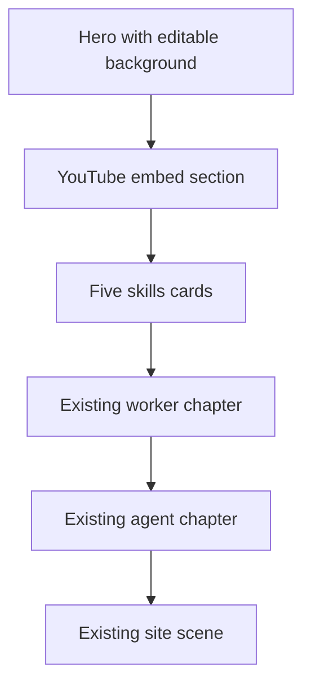

# Hero, video, and skills rail

## Brand and copy (locked)

Replace Human Operator-style site tags with BOB identity everywhere this pass touches:

- Wordmark / nav: **B.O.B**
- Expansion under the brand in the hero: **Building-site Observation Bot**
- Hero claim stays a BOB product sentence (not “We gave AI a body”). Draft for [`web/src/data/copy.ts`](web/src/data/copy.ts):
  - Eyebrow: `Building-site Observation Bot`
  - Title: existing claim or tightened form of “See the worksite. Know what is still unknown.”
  - Supporting sentence: what BOB is — a construction-site inspection robot that observes people and PPE, checks the worksite’s selected requirements, and keeps gaps visible. No invented metrics, no navigation/safety claims.

Update [`web/Design.md`](web/Design.md) hero and brand sections so they match this wording. Do not import Human Operator logos, fonts from Google CDN, or their meta tags.

## New page order

Insert after the current hero, before the existing worker / agent / scene chapters:

## 1. Hero: more text + editable background

Change [`web/src/components/Hero.tsx`](web/src/components/Hero.tsx):

- Full-viewport section; brand **B.O.B** as the hero-level signal, then the expansion line, then the headline, then a longer supporting paragraph (more text under the hero claim, as requested).
- Background image slot from [`web/src/data/media.ts`](web/src/data/media.ts), e.g. `heroBackground: { src: string; alt: string } | null`.
  - When `src` is set: full-bleed `object-cover` image behind the type, with a dark scrim so ink stays readable.
  - When null: solid `canvas` (current look). No stock stand-in image.
- Keep scroll cue. Do not put floating badges on the hero media.

Document the file path convention in Design.md: `public/media/hero/` + manifest entry.

## 2. YouTube section (before skills)

New component [`web/src/components/VideoSection.tsx`](web/src/components/VideoSection.tsx), same rhythm as Human Operator’s 16:9 embed shell (rounded frame, inset), adapted to BOB’s dark page:

- Config: `copy.video.youtubeId` (string). Default **empty**.
- When set: privacy-friendly embed `https://www.youtube-nocookie.com/embed/{id}` with `title` from copy, `rel=0`, no autoplay.
- When empty: same shell, labeled empty state (“Add a YouTube video ID in copy”) so layout is reserved and the ID is one-line editable later.
- This is the one intentional network dependency for the product page; fonts and other assets stay local.

## 3. Skills rail (five cards)

New component [`web/src/components/SkillsRail.tsx`](web/src/components/SkillsRail.tsx), matching the Human Operator demo-card structure from your screenshot and their HTML: media on top, title, short sentence; five items; horizontal scroll rail on wide screens (not a white marketing theme for the whole site).

**Look (locked):** light band under the dark page (`bg-zinc-50`-equivalent tokens added for this band only: `skills-band`, `skills-card`, `skills-ink`, `skills-muted`) so the cards read like the reference. Rest of the product page stays dark.

**Media:** each card’s image/video path comes from `media.skills[]`. Until files exist, cards still render with title + body and a dark empty media plate (same aspect as HO cards, ~4:5), so the grid is demonstrable. Replacing a path lights that plate. Prefer still images; if a `.mp4` is provided later, that card can use muted looping video like HO.

**Draft ability copy (editable in `copy.skills`):**

1. **See people and PPE.** The frame is checked for people and the gear on them.
2. **Match the worksite rules.** Only the requirements that worksite selected are assessed.
3. **Keep the evidence.** Findings stay on the source frame, session, and model.
4. **Leave gaps as gaps.** Occluded or unsupported checks stay not assessed.
5. **Hand over an honest record.** Supervisors see what was checked and what is still unknown.

Same text density as the reference (short title + one sentence). No Human Operator EMS/piano wording.

Motion: shared `Reveal` entrance; horizontal rail scrolls with CSS scroll-snap (no custom scroll hijack). Document in [`web/Motion.md`](web/Motion.md).

## 4. Wire-up and docs

- [`web/src/routes/ProductPage.tsx`](web/src/routes/ProductPage.tsx): `Hero` → `VideoSection` → `SkillsRail` → existing chapters.
- Nav wordmark becomes **B.O.B** via `copy.wordmark`.
- Refresh Design.md / Motion.md for hero background, video, and skills band.
- No hub / `bobapp` / `vision` changes. Dashboard route unchanged.

## Check

- `npm run build` in `web/`.
- Browser: hero shows B.O.B + expansion + longer text; background appears only when media is set; video shell present; five skills cards visible with HO-like structure; rest of page still scrolls to agents and scene.
- Narrow viewport: skills cards stack or scroll horizontally without clipping titles.
